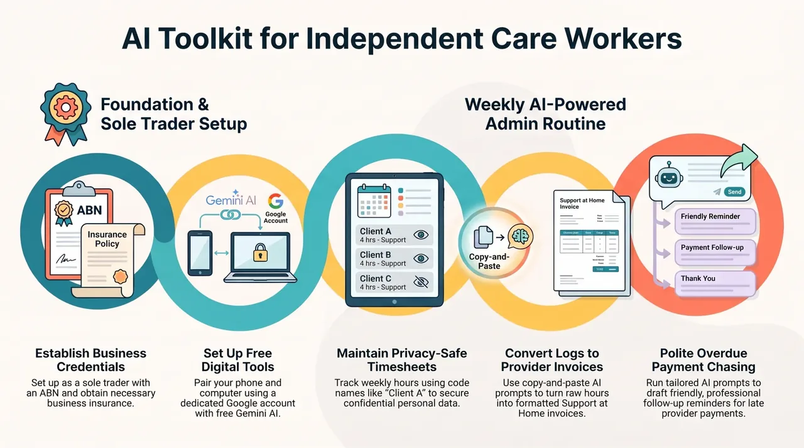

# AI Care Worker Kit

A free kit for independent aged care and home care workers in Australia: cleaners, gardeners, support workers and anyone else working for clients on Support at Home, including clients who self-manage. It shows you how to use free AI chat tools to do the paperwork side of a one-person business, so you spend less time at the kitchen table on a Sunday night and more time doing the work you're good at.

It's made by Colin Dixon of [CarePlan.au](https://careplan.au), who manages care for his mum in Mallacoota and has seen how much time workers lose to invoices sent back for small mistakes.

## What is GitHub?

GitHub is the free website where this kit lives. You don't need an account or any technical knowledge to use it. Open a file, such as one of the [prompts](prompts/), and copy the text you need. To take the whole kit with you, click the green **Code** button near the top of the [kit's main page](https://github.com/coldix/ai-care-worker-kit), then **Download ZIP**. The Google Sheets invoice and timesheet is one file you download and upload to your own Drive (step 9 of the whole setup).

## Start here

Nothing set up yet? Follow **[Start from scratch: the whole setup](docs/start-here-whole-setup.md)**: choose a computer that matches your phone, set it up securely, then one free Google account with Gemini. A weekend to set up, then half an hour each Friday.

## What's inside

The [docs](docs/) folder explains the basics in plain English: [getting set up as a sole trader](docs/getting-set-up.md), [invoicing a Support at Home provider](docs/invoicing-a-provider.md), [getting approved by a provider](docs/getting-approved.md), [chasing late payments politely](docs/late-payments.md), [keeping a weekly timesheet](docs/timesheets.md), and [which free AI tool to use](docs/free-ai-tools.md).

The [prompts](prompts/) folder has copy and paste prompts for the jobs you do every week, such as turning your week into an invoice or writing a friendly overdue reminder. Each one has a privacy note.

The [templates](templates/) folder has a simple invoice and timesheet, in Markdown and as CSV files, plus a ready-made [Google Sheets invoice and timesheet](templates/care-worker-invoice-and-timesheet.xlsx) with automatic invoice numbers and totals.

## Before you start

This kit is free and always will be. It's general information, not financial, tax or legal advice. Rules change, so each document says when it was last checked and links to the official source. If your situation is unusual, talk to the ATO, a registered tax agent or [business.gov.au](https://business.gov.au/).

CarePlan.au and this kit are independent. They are not run by the government or by any aged care provider, and nobody pays to be mentioned.

AI tools make mistakes. Always read what they give you before you send it, and check every number.

## Keep your private details in one safe place

Make one private Google Doc called "My business details" in your own Drive, and never share it. Put your ABN, your bank details (BSB and account number), your hourly rates, and the names, addresses and emails of the providers you invoice in it. Keep your list of client codes there too, so "Client A" in a chat means nothing to anyone else. There's a fill-in [template](templates/my-business-details.md) to copy. When you make an invoice, Gemini can read the doc if you type @Drive or attach it, so you don't retype your bank details into chats. Never put these details in a public copy of this kit on GitHub, in a shared folder, or in an AI tool with training turned on. (Programmers call this idea a ".env file". You don't need one.)

## Privacy, in one line

Never paste a client's Medicare number, date of birth, health details, address or full name into an AI tool. Use initials or a code like "Client A", and keep the real details in your own records.

## Licence

The documents, prompts and templates are shared under [CC BY 4.0](LICENSE). You can copy, share and adapt them, including for paid work, as long as you credit CarePlan.au.

Found a mistake or have a better prompt? Open an issue, or tell Colin through [careplan.au](https://careplan.au/about/#contact).
